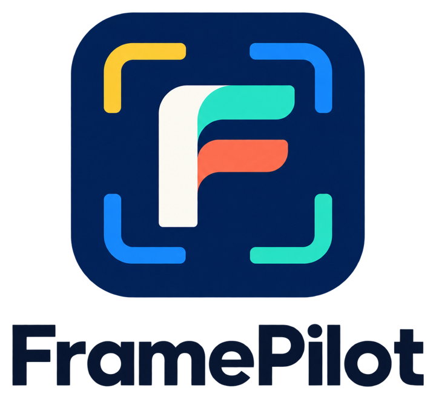
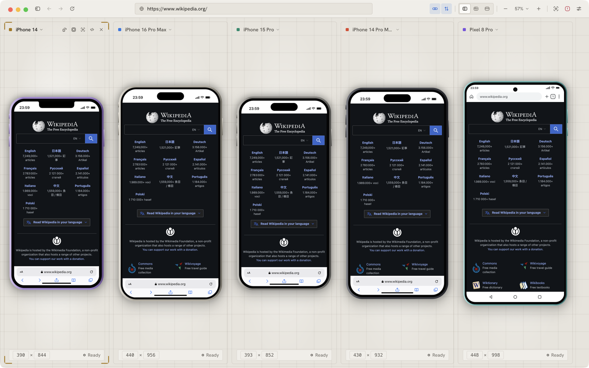

<p align="center">
  <picture>
    <source media="(prefers-color-scheme: dark)" srcset="docs/assets/logo-dark.png">
    
  </picture>
</p>

<h1 align="center">FramePilot</h1>

<p align="center"><strong>Every Screen. One Cockpit.</strong></p>

<p align="center">
  An open-source responsive web development browser for macOS: live, independent Chromium views of your site,
  side by side in realistic device frames. An alternative to Blisk.
</p>

<p align="center">
  <a href="https://github.com/alfabaria/framepilot/releases/latest"></a>
  
  <a href="LICENSE"></a>
</p>

<p align="center">
  <picture>
    <source media="(prefers-color-scheme: dark)" srcset="docs/screenshots/screenshot-dark.png">
    
  </picture>
</p>

FramePilot opens your site in several devices at once. Each device is a real, separate Chromium browser view with its
own history, cookies and page state, not a screenshot or an iframe. Click, scroll and type in any of them, and
navigation and scrolling can stay in sync across all of them.

## Download

**macOS (Apple Silicon), version 0.1.0**

1. Download `FramePilot-0.1.0-arm64.dmg` from the [latest release](https://github.com/alfabaria/framepilot/releases/latest).
2. Open the DMG and drag **FramePilot** onto the **Applications** folder.
3. The app is not signed or notarized yet, so macOS blocks the first launch. Right-click FramePilot in Applications,
   choose **Open**, then confirm. If macOS still refuses, run:

   ```sh
   xattr -dr com.apple.quarantine /Applications/FramePilot.app
   ```

Each release lists a SHA-256 checksum for the DMG.

| Platform | Status |
| --- | --- |
| macOS, Apple Silicon (arm64) | Supported, DMG in each release |
| macOS, Intel (x64) | Not built yet; you can [build from source](#build-from-source) |
| Windows, Linux | Not supported yet |

## Features

- **Side-by-side devices.** Up to six at once, in horizontal, grid or stacked layouts. Drag to reorder, add and remove
  devices, and resize each panel.
- **About 100 devices with their own frames.** iPhone SE to 16 Pro Max, iPads, Galaxy S6 to S24 Ultra, Pixel to Pixel 8
  Pro, iMac, MacBook and generic monitors. Each frame is original vector artwork drawn for that model (notch, Dynamic
  Island, punch-hole camera or home button, bezel, finish), with a status bar and browser toolbar inside, soft shadows,
  and rotation for phones and tablets. A borderless mode is available too.
- **Independent browsers.** Every device has its own session, history, cookies and page state.
- **Device emulation.** Per-profile viewport, device pixel ratio, user agent and client hints, touch emulation, and
  portrait or landscape orientation. Custom viewport sizes are supported. On phones and tablets the mouse acts as a
  finger: drag to swipe, Shift-drag to pinch.
- **Sync.** Optional URL synchronization and proportional scroll synchronization, each toggled separately.
- **Address bar with history.** Recent pages are suggested as you type and are remembered between launches.
- **Zoom and fit.** Zoom the workspace without changing any device's CSS viewport. Fit all previews, fit the selected
  width, or return to actual size.
- **Capture and DevTools.** Save a PNG of one device or all of them, and open Chromium DevTools for any device.
- **Themes.** System, Light or Dark.
- **Safe by default.** Websites run sandboxed with context isolation, no Node.js, no preload and no popups, and only
  `http(s)` navigation is allowed.
- **Local first.** No account, no cloud, no telemetry. Your workspace is saved on your machine.

> **Emulation limits.** FramePilot emulates devices in Chromium. It is not iOS Safari, Android hardware or a
> physical-device test lab, so always confirm important behavior on real devices.

## Roadmap

Not implemented yet: multiple tabs, DevTools docked inside the workspace, auto-refresh on file changes, network
throttling presets, named and saved workspaces, screenshot annotation, and Windows and Linux builds.
[Implementation status](docs/IMPLEMENTATION.md) lists what has been verified and how.

## Build from source

Requirements: macOS, Node.js 24 and npm.

```sh
git clone https://github.com/alfabaria/framepilot.git
cd framepilot
npm ci
npm run dev        # run in development
```

```sh
npm test           # unit tests
npx tsc --noEmit   # type check
npm run build      # production build
npm run package    # macOS DMG in dist/
```

`npm run test:fixture` serves a local test page on `127.0.0.1:4179` for manual multi-device checks. See
[testing notes](docs/TESTING.md) for the manual acceptance checklist.

## Project layout

- `src/main/` Electron main process: windows, browser views, emulation, navigation, sync, capture, persistence, IPC validation.
- `src/preload/` the narrow bridge exposed to the app UI.
- `src/renderer/` the React workspace, device chrome and the vector frame renderer.
- `src/shared/` the device catalog, frame geometry, workspace types and URL helpers.
- `tests/` deterministic tests and the local browser fixture.
- `docs/` [architecture](docs/ARCHITECTURE.md), [design decisions](docs/RFC.md), [status](docs/IMPLEMENTATION.md) and [testing](docs/TESTING.md).

## Contributing

Issues and pull requests are welcome. Please run `npm test` and `npx tsc --noEmit` before opening a pull request. Read
[AGENTS.md](AGENTS.md) for the security and architecture rules the code follows, in particular that website content
never receives Node.js or broad IPC access.

## Disclaimer

FramePilot is an independent project and is not affiliated with, endorsed by or derived from Blisk. It contains no
Blisk code or artwork. All product names, logos and trademarks mentioned belong to their owners.

## License

[MIT](LICENSE) © 2026 Alfa Ibrahim Daulat Baria
