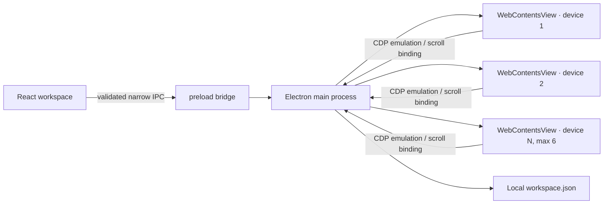

# Architecture

## Runtime boundaries

FramePilot uses Electron 35, TypeScript, React 19, Vite, Zustand, Zod, and Lucide. The packaged target is macOS. Node 24 is the requested development runtime.

- **Renderer:** React owns controls and the visual workspace. It reports each device's page-viewport bounds to the main process and marks the native view visible only when its entire viewport is inside the scrollable canvas, because a native view cannot be clipped (nesting views in a container did not clip them either). Hidden previews are replaced by a snapshot of their last frame, captured by the main process and drawn by the renderer as ordinary clipped DOM. Workspace and panel zoom scale the native WebContents surface (minimum 0.25). `src/renderer/device-chrome.tsx` draws the iOS/Android status bar and browser toolbars behind the frame artwork; `deviceInsets`/`contentViewport` in `src/shared/devices.ts` reserve that space so the native view covers only the page area.
- **Preload:** Exposes explicit operations and event subscriptions through `contextBridge`; no generic `ipcRenderer` access.
- **Main:** Owns independent `WebContentsView`s, profile/orientation emulation, view bounds, navigation policy, URL/scroll synchronization, DevTools, screenshots, and workspace persistence. IPC values are validated with Zod and sender frames must exactly match the trusted renderer URL.
- **Website views:** Each gets a persistent partition and a sandboxed, context-isolated webContents with Node integration disabled, no preload, no popups, denied permission requests, and HTTP(S)-only navigation. Website content never receives FramePilot IPC.

## Device and frame model

`DeviceProfile` contains category, CSS width/height, DPR, mobile/touch flags, UA, a typed frame key, and a chrome kind. `WorkspaceDevice` carries per-instance viewport/orientation, frame mode, panel scale, URL, and identity. Emulated metrics use the content viewport (oriented screen minus device chrome) and the current presentation scale for every profile: Chromium's mobile emulation renders its whole emulated surface regardless of the native view's bounds, so previews are emulated as non-mobile viewports whose DIP size matches the view, with DPR divided and page zoom multiplied by the scale. Touch emulation, the profile user agent, and client-hint metadata are applied through CDP after each navigation starts and on device updates; the user agent is also set with `webContents.setUserAgent` before the first request. CDP metrics are never applied before navigation begins because that ordering previously crashed on macOS.

`src/renderer/device-frames.ts` maps each profile key to the supplied `frame-01.png`…`frame-10.png` images, including desktop and laptop profiles, and records the normalized transparent screen aperture measured from each asset. The frame artwork is scaled to place that aperture exactly under the native `.device-screen`/`WebContentsView` bounds. When orientation differs from the profile's base orientation, artwork and aperture geometry rotate together. Borderless mode omits the artwork without replacing the browsing instance. The supplied frames are illustrative artwork, not certified device CAD.

The header and startup mark are `src/renderer/assets/framepilot-logo-dark.png` and `framepilot-logo-light.png`, selected by theme. `assets/framepilot.icns` supplies the packaged macOS app icon (the navy-tile light artwork).

## Synchronization

- **URL:** Address-bar submissions load the normalized URL into every active view when URL sync is enabled. Main-frame navigation and in-page URL changes also propagate. Per-target navigation revisions and locks suppress stale echoes.
- **Scroll:** A document-level passive capture listener reports the normalized `scrollTop / (scrollHeight - innerHeight)` ratio over a CDP runtime binding installed in each page's default execution context. The main process clamps and applies that ratio to each other document's own scrollable range. The observer is reinstalled after every completed navigation. Updates are throttled to roughly 30 per second without depending on `requestAnimationFrame`, which can pause in background webContents. Nested independently scrollable elements are outside this contract.

## Trust and data

The renderer shell uses a restrictive CSP and exact trusted-frame checks. Only HTTP(S) website URLs can be navigated; file, JavaScript, data, and other schemes are rejected. Popups and downloads are denied, and website permission requests/checks are denied. Local settings are validated and saved with owner-only file permissions under Electron `userData`. Screenshots are actual Chromium `capturePage()` PNGs written to a folder selected by the user.

Workspace persistence uses schema version 2. Versionless settings migrate to horizontal layout, synchronized URLs/scroll, mapped frames for desktop/laptop, and one shared starting URL; current-version explicit settings are preserved.

## Known boundaries

- Chromium emulation is not WebKit/iOS or physical hardware.
- Six views are a configured cap, not a performance guarantee; each page consumes browser/GPU resources.
- Scroll sync covers the document scroller, not arbitrary nested scroll containers.
- Behavior is described by what has been run and tested, not by assumptions about other products. See `docs/IMPLEMENTATION.md`.
- P1 capabilities that are not part of the current verified P0 baseline are listed explicitly in `docs/IMPLEMENTATION.md`.
